# 오늘의 모찌 ERD

기준: Figma `목업_모찌의 기록실` · 짝 문서: [API 명세](README.md) · 스키마 원본: `backend/src/main/resources/db/migration`

## 공통 규칙

| 항목 | 규칙 |
|---|---|
| DB | PostgreSQL. 스키마는 Flyway만 바꾼다 (`ddl-auto: validate`) |
| 마이그레이션 | 이미 머지된 `V*.sql`은 고치지 않고 새 버전을 추가한다 |
| PK | `bigint generated by default as identity`. 이름은 `{테이블}_id` |
| 일시 | `timestamptz`. 날짜만 필요한 값(`record_date`)은 `date` |
| 고정값 | 감정·상태·등급 등은 `varchar` + Java Enum. DB에 CHECK를 두지 않는다 |
| 삭제 | `member`, `diary`, `my_icon`은 `deleted_at`으로 소프트 삭제. 나머지는 하드 삭제 |
| 인덱스 이름 | 유니크 `uq_{테이블}_{컬럼}`, 일반 `ix_{테이블}_{컬럼}` |

## 테이블 목록

| 도메인 | 테이블 | 역할 | 상태 |
|---|---|---|---|
| 회원 | `member` | 회원 | V1, V4 |
| | ~~`member_setting`~~ | 기록 알림 설정. V10에서 삭제 | V1, V10 |
| | `terms_agreement` | 약관 동의 이력 | V1 |
| | `push_device` | 기기별 FCM 토큰 | V1 |
| 인증 | `member_session` | 로그인 세션 (회원당 1개) | V5 |
| | `signup_ticket` | 닉네임 입력 전 임시 가입 티켓 | V5 |
| 공통 | `idempotency_record` | `Idempotency-Key` 처리 기록 | V2 |
| 일기 | `emoticon` | 감정 이모티콘 (감정당 1개, 미리 등록) | V7 |
| | `my_icon` | 회원이 만든 아이콘 (글자만) | V7, V9 |
| | `diary` | 하루 기록 | V3, V7 |
| | `diary_icon` | 일기-내 아이콘 연결 | V7 |
| | `diary_image` | 일기 그림 (일기당 1개) | V3, V7, V8 |
| 감정 검색 | `emotion_search` | 질문·답변 | V6 |
| | `emotion_search_result` | 답변 근거 기록 | V6 |
| | `diary_embedding` | 일기 의미 검색용 임베딩 (1:1, 한 줄 일기가 있는 일기만) | V6 |
| 뽑기 | `gacha_tier` | 등급별 가중치·별조각 규칙 (6행, 기본 모찌 `NONE` 포함) | V11, V15 |
| | `mozzi_card` | 카드 마스터 | V11 |
| | `member_card` | 회원 도감 | V11, V17 |
| | `gacha_draw` | 뽑기 1회 (1~10장) | V11 |
| | `gacha_draw_result` | 뽑기 결과 카드 | V11 |
| | `member_wallet` | 뽑기권·별조각 잔액 (1:1) | V11 |
| | `wallet_ledger` | 뽑기권·별조각 입출금 장부 | V11 |

마이그레이션을 추가할 때 이 문서도 함께 고친다.

## 다이어그램

키 컬럼만 표시했다. 전체 컬럼은 아래 도메인별 표를 본다.

```mermaid
erDiagram
    member ||--o{ terms_agreement : ""
    member ||--o{ push_device : ""
    member ||--o| member_session : ""
    member ||--o{ idempotency_record : ""

    member ||--o{ diary : ""
    member ||--o{ my_icon : ""
    emoticon ||--o{ diary : ""
    diary ||--o{ diary_icon : ""
    my_icon ||--o{ diary_icon : ""
    diary ||--o| diary_image : ""

    member ||--o{ emotion_search : ""
    emotion_search ||--o{ emotion_search_result : ""
    diary ||--o{ emotion_search_result : ""
    diary ||--o| diary_embedding : ""

    gacha_tier ||--o{ mozzi_card : ""
    member ||--o{ member_card : ""
    mozzi_card ||--o{ member_card : ""
    member ||--o{ gacha_draw : ""
    gacha_draw ||--|{ gacha_draw_result : ""
    mozzi_card ||--o{ gacha_draw_result : ""
    member ||--o| member_wallet : ""
    member ||--o{ wallet_ledger : ""

    member {
        bigint member_id PK
    }
    terms_agreement {
        bigint terms_agreement_id PK
        bigint member_id FK
    }
    push_device {
        bigint push_device_id PK
        bigint member_id FK
    }
    member_session {
        bigint member_id PK, FK
    }
    signup_ticket {
        bigint signup_ticket_id PK
    }
    idempotency_record {
        bigint idempotency_record_id PK
        bigint member_id FK
    }
    emoticon {
        bigint emoticon_id PK
    }
    my_icon {
        bigint my_icon_id PK
        bigint member_id FK
    }
    diary {
        bigint diary_id PK
        bigint member_id FK
        bigint emoticon_id FK
    }
    diary_icon {
        bigint diary_id PK, FK
        bigint my_icon_id PK, FK
    }
    diary_image {
        bigint diary_image_id PK
        bigint diary_id FK
    }
    emotion_search {
        bigint emotion_search_id PK
        bigint member_id FK
    }
    emotion_search_result {
        bigint emotion_search_id PK, FK
        bigint diary_id PK, FK
    }
    diary_embedding {
        bigint diary_id PK, FK
    }
    gacha_tier {
        varchar tier PK
    }
    mozzi_card {
        bigint card_id PK
        varchar tier
    }
    member_card {
        bigint member_card_id PK
        bigint member_id FK
        bigint card_id FK
    }
    gacha_draw {
        bigint draw_id PK
        bigint member_id FK
    }
    gacha_draw_result {
        bigint draw_id PK, FK
        int seq PK
        bigint card_id FK
    }
    member_wallet {
        bigint member_id PK, FK
    }
    wallet_ledger {
        bigint wallet_ledger_id PK
        bigint member_id FK
    }
```

`signup_ticket`은 회원이 만들어지기 전 데이터라 FK가 없다.

---

## 회원 · 인증

### member

| 컬럼 | 타입 | 키 | NULL | 설명 |
|---|---|---|---|---|
| member_id | bigint | PK | | |
| email | varchar(255) | | | Google 이메일 |
| nickname | varchar(12) | | | 2~10자 (DB는 12자까지 허용) |
| provider | varchar(20) | | | `GOOGLE` |
| provider_subject | varchar(255) | | | Google `sub`. 이메일은 바뀔 수 있어 식별은 이 값으로 |
| role | varchar(20) | | | `USER`, `ADMIN` |
| status | varchar(20) | | | `ACTIVE` → `WITHDRAWN` |
| created_at | timestamptz | | | |
| updated_at | timestamptz | | | |
| deleted_at | timestamptz | | O | 탈퇴 시각 |

- `uq_member_active_provider_subject (provider, provider_subject) where deleted_at is null` — 탈퇴 후 같은 Google 계정으로 재가입 가능
- `uq_member_active_nickname (lower(nickname)) where deleted_at is null` — 대소문자 무시 중복 검사

### terms_agreement

| 컬럼 | 타입 | 키 | NULL | 설명 |
|---|---|---|---|---|
| terms_agreement_id | bigint | PK | | |
| member_id | bigint | FK | | |
| terms_type | varchar(20) | | | `TERMS`, `PRIVACY` |
| terms_version | varchar(20) | | | `1.0` |
| agreed_at | timestamptz | | | |

- `ix_terms_agreement_member (member_id)`

### push_device

| 컬럼 | 타입 | 키 | NULL | 설명 |
|---|---|---|---|---|
| push_device_id | bigint | PK | | |
| member_id | bigint | FK | | |
| device_id | varchar(64) | | | 앱이 만든 UUID |
| platform | varchar(10) | | | `IOS`, `ANDROID` |
| token | varchar(512) | | | FCM 토큰 |
| is_active | boolean | | | 로그아웃하면 `false`. 다른 기기에서 등록하거나 다른 회원이 같은 토큰을 등록해도 `false` |
| updated_at | timestamptz | | | 마지막으로 등록·비활성화된 시각 |

- `uq_push_device_member_device (member_id, device_id)` — 같은 기기는 덮어쓴다
- 회원 탈퇴 시 행을 지운다

### member_session

| 컬럼 | 타입 | 키 | NULL | 설명 |
|---|---|---|---|---|
| member_id | bigint | PK, FK | | PK라서 회원당 세션 1개 |
| session_id | uuid | | | 로그인마다 새로 발급. Access 토큰에 담긴다 |
| refresh_token_hash | varchar(64) | | | Refresh 토큰의 SHA-256. 원문은 저장하지 않는다 |
| refresh_expires_at | timestamptz | | | 재발급마다 +30일 |
| created_at | timestamptz | | | |
| updated_at | timestamptz | | | |

- `uq_member_session_session_id (session_id)`
- `ix_member_session_refresh_expires_at (refresh_expires_at)` — 만료 정리 배치

### signup_ticket

| 컬럼 | 타입 | 키 | NULL | 설명 |
|---|---|---|---|---|
| signup_ticket_id | bigint | PK | | |
| token_hash | varchar(64) | | | 티켓의 SHA-256 |
| provider | varchar(20) | | | |
| provider_subject | varchar(255) | | | |
| email | varchar(255) | | | |
| expires_at | timestamptz | | | 발급 후 10분 |
| created_at | timestamptz | | | |
| updated_at | timestamptz | | | |

- `uq_signup_ticket_token_hash (token_hash)`, `ix_signup_ticket_expires_at (expires_at)`
- 가입이 끝나면 `member` 생성과 같은 트랜잭션에서 지운다. 만료분은 배치가 지운다

### idempotency_record

| 컬럼 | 타입 | 키 | NULL | 설명 |
|---|---|---|---|---|
| idempotency_record_id | bigint | PK | | |
| member_id | bigint | FK | | |
| endpoint | varchar(100) | | | 예: `POST /diaries` |
| idempotency_key | varchar(64) | | | 헤더 값 |
| request_hash | varchar(64) | | | 본문 SHA-256. 다르면 `409 IDEMPOTENCY_CONFLICT` |
| status | varchar(12) | | | `IN_PROGRESS`, `COMPLETED` |
| response_status | integer | | O | 첫 응답 재사용용 |
| response_body | text | | O | |
| created_at | timestamptz | | | |
| completed_at | timestamptz | | O | |
| expires_at | timestamptz | | | |

- `uq_idempotency_record_scope (member_id, endpoint, idempotency_key)`
- 일기 작성, 다시 그리기, 뽑기, 교환이 모두 이 테이블을 쓴다. 도메인 테이블에 키 컬럼을 따로 두지 않는다

---

## 일기

`activity`·`diary_activity`(V3)는 V7에서 지운다. 활동 칩은 회원이 만드는 아이콘(`my_icon`)으로 바뀌었다.

### emoticon

감정 하나에 이모티콘 하나. 서버가 미리 등록한다.

| 컬럼 | 타입 | 키 | NULL | 설명 |
|---|---|---|---|---|
| emoticon_id | bigint | PK | | |
| emotion | varchar(10) | | | `HAPPY`, `CALM`, `NEUTRAL`, `SAD`, `ANGRY` |
| image_url | varchar(255) | | | S3 공개 URL |
| created_at | timestamptz | | | |
| updated_at | timestamptz | | | |

- `uq_emoticon_emotion (emotion)`

### my_icon

회원이 장소·누구와·무엇을 탭에서 만든 아이콘. 이미지 없이 이름만 있다.

| 컬럼 | 타입 | 키 | NULL | 설명 |
|---|---|---|---|---|
| my_icon_id | bigint | PK | | |
| member_id | bigint | FK | | |
| name | varchar(10) | | | 중복 허용 |
| category | varchar(10) | | | `WHERE`, `WHO`, `WHAT` |
| created_at | timestamptz | | | 목록 정렬 기준 |
| updated_at | timestamptz | | | |
| deleted_at | timestamptz | | O | 소프트 삭제 |

- `ix_my_icon_member_category (member_id, category, created_at) where deleted_at is null` — 카테고리별 목록, 30개 제한 개수 세기
- V9 변경: `icon_id` 삭제, `icon` 테이블 삭제 (아이콘이 글자만 쓰는 방식으로 바뀜)
- 카테고리당 30개 제한은 애플리케이션이 센다. 동시에 두 개를 만들어 31개가 되지 않도록 `member` 행을 잠그고(`select … for update`) 센다

### diary

| 컬럼 | 타입 | 키 | NULL | 설명 |
|---|---|---|---|---|
| diary_id | bigint | PK | | |
| member_id | bigint | FK | | |
| record_date | date | | | 기록한 날. 서버가 저장 시점의 오늘(Asia/Seoul)을 넣는다 |
| emoticon_id | bigint | FK | | |
| emotion | varchar(10) | | | `emoticon.emotion` 복사본. 캘린더·감정 필터에서 조인 없이 쓴다 |
| content | varchar(50) | | O | 한 줄 일기 |
| created_at | timestamptz | | | |
| updated_at | timestamptz | | | |
| deleted_at | timestamptz | | O | 소프트 삭제. 지금은 삭제 API가 없다 |

- `uq_diary_member_record_date (member_id, record_date) where deleted_at is null` — 하루 1기록. 동시에 두 번 저장하면 두 번째를 DB가 거절한다. 최신순 조회에도 이 인덱스를 쓴다
- `ix_diary_member_emotion_record_date (member_id, emotion, record_date)` — 감정 필터·감정 검색
- V7 변경: `memo varchar(100)` → `content varchar(50)`, `emoticon_id` 추가, `title`·`current_image_id` 삭제, `image_status` → `diary_image_status` (NULL 허용)
- V16 변경: `diary_image_status` 삭제. `diary_image.status`를 복사만 하고 읽는 곳이 없었다

### diary_icon

| 컬럼 | 타입 | 키 | NULL | 설명 |
|---|---|---|---|---|
| diary_id | bigint | PK, FK | | |
| my_icon_id | bigint | PK, FK | | |

- PK가 같은 아이콘을 두 번 붙이는 것을 막는다
- 삭제한 `my_icon`은 행을 지우지 않고 조회할 때 뺀다

### diary_image

일기당 1행. 실패 후 다시 요청하면 새 행을 만들지 않고 같은 행을 `PENDING`으로 되돌려 고른 값을 덮어쓴다.

| 컬럼 | 타입 | 키 | NULL | 설명 |
|---|---|---|---|---|
| diary_image_id | bigint | PK | | |
| diary_id | bigint | FK | | |
| status | varchar(12) | | | `PENDING`, `SUCCEEDED`, `FAILED` |
| failure_count | integer | | | AI 서버가 보낸 실패와 유해성 판정으로 막힌 요청을 센다 (번역·큐 전송 실패는 제외). 기본 0. 3이 되면 더 요청할 수 없다 |
| mozzi_card_id | bigint | FK | O | 그림에 들어갈 모찌. 요청할 때 그 일기 감정에 고른 내 모찌(`my_mozzi_emoticon`). 없으면 `null`이고 기본 캐릭터로 그린다 |
| time_of_day | varchar(10) | | O | `MORNING`, `LUNCH`, `EVENING` |
| weather | varchar(10) | | | `NONE`(입력되지 않음), `SUNNY`, `CLOUDY`, `RAINY`, `SNOWY`. 기본 `NONE` |
| where_name | varchar(10) | | O | 고른 `WHERE` 아이콘 이름 |
| who_name | varchar(10) | | O | 고른 `WHO` 아이콘 이름 |
| what_name | varchar(10) | | | 고른 `WHAT` 아이콘 이름 |
| image_url | varchar(255) | | O | S3 공개 URL. 파일 이름은 UUID라 추측할 수 없다. 완성 전·실패 시 `null` |
| created_at | timestamptz | | | 처음 요청한 시각 |
| updated_at | timestamptz | | | |

- `uq_diary_image_diary (diary_id)` — 일기당 1행
- 타임아웃이 없다. `PENDING`인 동안은 다시 요청할 수 없으므로, AI 서버의 결과는 일기 ID만으로 지금 요청에 반영된다
- 아이콘은 ID가 아니라 이름을 복사해 둔다. 아이콘을 지워도 그림이 무엇으로 만들어졌는지 남는다
- 요청 처리: `diary` 행을 잠그고(`select … for update`) 이 표의 `status`를 확인한 뒤 저장한다. 같은 일기에 동시에 온 두 번째 요청은 첫 요청이 커밋될 때까지 기다렸다가 `PENDING`을 보고 거절된다
- V7 변경: `attempt_no`, `stage`, `trigger_type`, `prompt`, `model`, `failure_code`, `requested_at`, `started_at`, `completed_at` 삭제, `image_key` → `image_url`
- V8 변경: `weather` 추가 (기본 `NONE`)
- 유해성 판정으로 막힌 이유는 저장하지 않는다. 앱에는 결과 푸시의 `code`로만 알린다

---

## 감정 검색

### emotion_search

| 컬럼 | 타입 | 키 | NULL | 설명 |
|---|---|---|---|---|
| emotion_search_id | bigint | PK | | API의 `searchId` |
| member_id | bigint | FK | | |
| question | varchar(200) | | | |
| interpreted_filter | jsonb | | O | LLM이 해석한 조건 (기간·감정·키워드). 해석 전에 실패하면 `null` |
| result_type | varchar(12) | | | `FOUND`, `EMPTY`, `STATS_ONLY`, `FAILED` |
| answer | varchar(500) | | O | |
| latency_ms | integer | | O | |
| created_at | timestamptz | | | |

- `ix_emotion_search_member_created_at (member_id, created_at)` — 분당 10회 제한, 최근 7일 검색 감정(주간 맥락)
- 90일 지난 행은 `ExpiredEmotionSearchCleaner`가 매일 04:40에 지운다 (API 결정 항목 #5)
- 질문·답변을 다시 보여 주는 API는 없다. 저장하는 이유는 제한·주간 맥락·근거 기록이다

### emotion_search_result

| 컬럼 | 타입 | 키 | NULL | 설명 |
|---|---|---|---|---|
| emotion_search_id | bigint | PK, FK | | |
| diary_id | bigint | PK, FK | | |
| rank_no | integer | | | 표시 순서 |
| is_featured | boolean | | | 큰 카드로 보여 줄 대표 기록 |

- `uq_emotion_search_result_rank (emotion_search_id, rank_no)` — 같은 순서가 둘이면 표시 순서가 모호하다
- `uq_emotion_search_result_featured (emotion_search_id) where is_featured` — 큰 카드는 검색당 하나
- `ix_emotion_search_result_diary (diary_id)` — 일기를 파기할 때 이 테이블 행을 먼저 찾는다
- 90일 배치는 이 테이블을 먼저 지우고 `emotion_search`를 지운다. 저장소 전체에서 `on delete cascade`를 쓰지 않는다

### diary_embedding

`keyword` 의미 검색용. 모델을 바꿀 때 `diary` 행을 건드리지 않고 다시 만들 수 있도록 테이블을 나눴다. pgvector 확장(`create extension vector`)이 필요하다.

| 컬럼 | 타입 | 키 | NULL | 설명 |
|---|---|---|---|---|
| diary_id | bigint | PK, FK | | |
| model | varchar(50) | | | 모델과 차원. `text-embedding-3-large@1536`. 설정과 다르면 다시 만든다 |
| content_hash | varchar(64) | | | 임베딩한 텍스트의 SHA-256. 같으면 다시 만들지 않는다 |
| embedding | vector(1536) | | | `text-embedding-3-large`를 `dimensions: 1536`으로 줄인 값. HNSW 한도(2,000차원) 안이다 |
| created_at | timestamptz | | | |
| updated_at | timestamptz | | | **쓴 시각이 아니라** 이 벡터를 만든 `diary.updated_at`. `diary.updated_at`보다 작으면 낡은 행이다 |

- 임베딩 텍스트는 날짜·감정·아이콘 이름·한 줄 일기를 합친 한 줄이다 (`2026-10-12 평온 / 공원, 엄마, 산책 / {content}`)
- 한 줄 일기(`content`)가 있는 일기만 만든다. 기간·감정은 SQL이 거르므로 글이 없는 일기는 의미 검색으로 찾을 게 없다
- 일기 작성이 커밋된 뒤 비동기로 만든다(`DiaryContentChangedEvent`). 실패해도 일기 저장은 성공이다. 일기 수정·삭제 API는 없다
- 5분마다 스윕이 놓친 행(갱신 실패, 기존 일기, 다른 모델)을 100건씩 채운다
- 저장은 `on conflict` upsert이고 `updated_at`이 더 새로운 쪽만 이긴다. 갱신이 연달아 와도 마지막 내용이 남는다
- 저장 직전에 원본 일기를 `for share`로 잠그고 삭제·버전을 다시 확인한다. GMS 응답을 기다리는 사이 지워진 일기의 벡터가 되살아나지 않는다
- 텍스트가 같으면(`content_hash`) GMS를 부르지 않고 `updated_at`만 올린다
- 일기를 삭제하면 같이 지운다. 탈퇴 파기 대상이다
- 후보를 SQL로 먼저 좁힌 뒤 정렬하므로 벡터 인덱스는 데이터가 쌓이면 검토한다

---

## 모찌 뽑기

`V11__create_gacha_tables.sql`이 테이블과 `gacha_tier` 5행을 만든다. `V15__add_none_gacha_tier.sql`이 기본 모찌용 `NONE` 행(가중치 0)을 더한다. 카드 데이터는 마이그레이션에 넣지 않는다. 규칙과 처리 순서는 [api/gacha.md](api/gacha.md)에 있다.

### gacha_tier

등급 규칙. `GET /gacha/rates`가 `NONE`을 뺀 행을 내려준다.

| 컬럼 | 타입 | 키 | NULL | 설명 |
|---|---|---|---|---|
| tier | varchar(10) | PK | | `NONE`(기본 모찌), `COMMON`, `RARE`, `EPIC`, `LEGENDARY`, `MYTHIC` |
| weight | integer | | | 추첨 가중치. 합 100,000 (45,000 / 30,000 / 17,000 / 7,000 / 1,000). `NONE`은 0 |
| duplicate_shards | integer | | | 중복 시 받는 별조각 (1, 2, 5, 15, 40) |
| exchange_cost | integer | | O | 교환에 드는 별조각. `LEGENDARY` 200, `MYTHIC` 400. 나머지는 `null`(교환 불가) |

- 기동할 때 뽑는 5개 등급이 다 있는지, 가중치 합이 100,000인지 검사한다. 실패하면 기동을 멈춘다. `NONE` 행은 `mozzi_card.tier` FK 때문에만 있고 검사·추첨에서 빠진다
- 변경: `gacha_season` 삭제에 따라 `season_id` 삭제, PK = `tier`. `rate numeric(6,5)` → `weight integer`. `exchange_cost` NULL 허용

### mozzi_card

| 컬럼 | 타입 | 키 | NULL | 설명 |
|---|---|---|---|---|
| card_id | bigint | PK | | |
| code | varchar(12) | | | `S2-01-04` |
| series | varchar(20) | | | `과일 모찌` |
| name | varchar(30) | | | `수박 모찌` |
| tier | varchar(10) | | | `NONE`이면 기본 모찌: 가입할 때 받고, 뽑기·도감에서 빠진다 |
| emotion | varchar(10) | | | `Emotion` |
| image_key | varchar(100) | | | 공개 S3 키 `cards/{code}_{원본 파일}_{감정 영문}.png`. URL은 `{mozzi.gacha.image-base-url}/{image_key}` |
| is_active | boolean | | | 뽑기·도감 대상 |

- `uq_mozzi_card_code (code)`
- `ix_mozzi_card_tier (tier) where is_active` — 등급 안에서 카드 추첨
- 이미지 버킷: `mozzi-dev-backend-645819131894`
- 변경: `season_id` 삭제. `ix_mozzi_card_season_tier` → `ix_mozzi_card_tier`

### member_card

| 컬럼 | 타입 | 키 | NULL | 설명 |
|---|---|---|---|---|
| member_card_id | bigint | PK | | |
| member_id | bigint | FK | | |
| card_id | bigint | FK | | |
| owned_count | integer | | | 뽑기·교환으로 얻은 횟수 (중복 포함) |
| first_acquired_at | timestamptz | | | |
| seen_at | timestamptz | | O | `null`이면 도감에 NEW 표시 |

- `ix_member_card_member (member_id)` — 보유 목록, 도감
- `uq_member_card_member_card (member_id, card_id)` — 같은 카드를 두 번 insert하는 것을 막는다 (동시성 최종 방어). 기본 모찌 지급의 `on conflict`도 이 인덱스를 쓴다
- V17 변경: 복합 PK `(member_id, card_id)` → 대리키 `member_card_id`, 두 컬럼은 유니크 인덱스로

### gacha_draw

뽑기 요청 1번 = 1행. 10장 뽑기도 1행이다.

| 컬럼 | 타입 | 키 | NULL | 설명 |
|---|---|---|---|---|
| draw_id | bigint | PK | | |
| member_id | bigint | FK | | |
| draw_count | integer | | | 1~10 |
| created_at | timestamptz | | | |

- `ix_gacha_draw_member_created_at (member_id, created_at)`
- 변경: `season_id` 삭제

### gacha_draw_result

| 컬럼 | 타입 | 키 | NULL | 설명 |
|---|---|---|---|---|
| draw_id | bigint | PK, FK | | |
| seq | integer | PK | | 뽑은 순서 1~10 |
| card_id | bigint | FK | | |
| tier | varchar(10) | | | 뽑힌 시점 등급 (확률 통계용 스냅샷) |
| first_acquired | boolean | | | P-03 "새로운 모찌" |
| shards_gained | integer | | | 중복이면 `gacha_tier.duplicate_shards`, 아니면 0 |

### member_wallet

| 컬럼 | 타입 | 키 | NULL | 설명 |
|---|---|---|---|---|
| member_id | bigint | PK, FK | | |
| ticket_balance | integer | | | `check (ticket_balance >= 0)`. 상한 없음 |
| shard_balance | integer | | | `check (shard_balance >= 0)`. 상한 없음 |
| updated_at | timestamptz | | | |

- 가입 트랜잭션에서 뽑기권 20, 별조각 0으로 만든다 (`SIGNUP` 장부와 함께). V11 이전에 가입한 회원은 V11이 같은 지갑과 장부를 만든다
- 잔액을 바꿀 때는 이 행을 잠그고(`select … for update`) 같은 트랜잭션에서 `wallet_ledger`를 쓴다. 같은 회원의 뽑기·교환·보상 지급이 이 잠금으로 직렬화된다

### wallet_ledger

| 컬럼 | 타입 | 키 | NULL | 설명 |
|---|---|---|---|---|
| wallet_ledger_id | bigint | PK | | |
| member_id | bigint | FK | | |
| currency | varchar(10) | | | `TICKET`, `SHARD` |
| amount | integer | | | 지급 `+`, 사용 `-` |
| reason | varchar(20) | | | 아래 표 |
| ref_id | bigint | | O | `reason`에 따라 가리키는 행 |
| reward_key | varchar(40) | | O | 보상 중복 방지 키. 아래 표 |
| created_at | timestamptz | | | |

| reason | currency | ref_id | reward_key |
|---|---|---|---|
| `SIGNUP` | TICKET + | null | `SIGNUP` |
| `DAILY_LOGIN` | TICKET + | null | `LOGIN:{yyyy-MM-dd}` |
| `DAILY_RECORD` | TICKET + | diary_id | `RECORD:{record_date}` |
| `CARE` | TICKET + | null | `CARE_PET:{yyyy-MM-dd}` · `CARE_FEED:{yyyy-MM-dd}` · `CARE_PLAY:{yyyy-MM-dd}` |
| `DRAW` | TICKET − | draw_id | null |
| `DUPLICATE` | SHARD + | draw_id | null (한 번 뽑기의 조각 합계 1행) |
| `EXCHANGE` | SHARD − | card_id | null |
| `EVENT`, `ADMIN` | 둘 다 | null | 운영자 지정 |

- `uq_wallet_ledger_ref (member_id, currency, reason, ref_id)` — `DRAW`·`DUPLICATE`·`EXCHANGE`를 같은 기록으로 두 번 쓰지 않는다. `ref_id`가 null인 행은 검사에서 빠진다
- `uq_wallet_ledger_reward_key (member_id, reward_key) where reward_key is not null` — 보상은 키당 1번. 지급은 `insert … on conflict (member_id, reward_key) where reward_key is not null do nothing`으로 하고, 0행이면 지급하지 않는다
- 잔액은 장부 합계와 같아야 한다
- 변경: `reward_date`와 `uq_wallet_ledger_diary_reward` 삭제 → `reward_key`. `DIARY_REWARD` → `DAILY_RECORD`

### 회원 탈퇴

탈퇴 파기에서 아래 순서로 지운다 (`on delete cascade` 없음).

1. `gacha_draw_result`
2. `gacha_draw`
3. `member_card`
4. `wallet_ledger`
5. `member_wallet`

---

## 결정이 필요한 항목

| # | 항목 | 현재 안 |
|---|---|---|
| 1 | 교환 비용 | 확정: 등급별(`gacha_tier.exchange_cost`). 전설 200, 신화 400, 일반·희귀·영웅은 교환 불가 |
| 2 | 한 달 애니메이션 (`monthly_animation`) | 2단계. API가 정해지면 추가 |
