# 오늘의 모찌 ERD

기준: Figma `목업_모찌의 기록실` · 짝 문서: [API 명세](README.md) · 스키마 원본: `backend/src/main/resources/db/migration`

## 공통 규칙

| 항목 | 규칙 |
|---|---|
| DB | PostgreSQL. 스키마는 Flyway만 바꾼다 (`ddl-auto: validate`) |
| 마이그레이션 | 이미 머지된 `V*.sql`은 고치지 않고 새 버전을 추가한다 |
| PK | `bigint generated by default as identity`. 이름은 `{테이블}_id` |
| 일시 | `timestamptz`. 날짜만 필요한 값(`record_date`)은 `date` |
| 고정값 | 감정·상태·등급 등은 `varchar` + Java Enum. DB에 CHECK를 두지 않는다 |
| 삭제 | `member`, `diary`는 `deleted_at`으로 소프트 삭제. 나머지는 하드 삭제 |
| 인덱스 이름 | 유니크 `uq_{테이블}_{컬럼}`, 일반 `ix_{테이블}_{컬럼}` |

## 테이블 목록

| 도메인 | 테이블 | 역할 | 상태 |
|---|---|---|---|
| 회원 | `member` | 회원 | V1, V4 |
| | `member_setting` | 기록 알림 설정 (1:1) | V1 |
| | `terms_agreement` | 약관 동의 이력 | V1 |
| | `push_device` | 기기별 FCM 토큰 | V1 |
| 인증 | `member_session` | 로그인 세션 (회원당 1개) | V5 |
| | `signup_ticket` | 닉네임 입력 전 임시 가입 티켓 | V5 |
| 공통 | `idempotency_record` | `Idempotency-Key` 처리 기록 | V2 |
| 일기 | `diary` | 하루 기록 | V3 |
| | `activity` | 활동 칩 마스터 | V3 |
| | `diary_activity` | 일기-활동 연결 | V3 |
| | `diary_image` | 그림 생성 시도 이력 | V3 |
| 감정 검색 | `emotion_search` | 질문·답변 | 예정 |
| | `emotion_search_result` | 답변 근거 기록 | 예정 |
| 뽑기 | `gacha_season` | 시즌 | 예정 |
| | `gacha_tier` | 시즌별 등급 확률·조각 규칙 | 예정 |
| | `mozzi_card` | 카드 마스터 | 예정 |
| | `member_card` | 회원 도감 | 예정 |
| | `gacha_draw` | 뽑기 1회 (1장 / 10장) | 예정 |
| | `gacha_draw_result` | 뽑기 결과 카드 | 예정 |
| | `member_wallet` | 뽑기권·조각 잔액 (1:1) | 예정 |
| | `wallet_ledger` | 뽑기권·조각 입출금 장부 | 예정 |

`예정` 테이블은 구현하면서 바뀔 수 있다. 마이그레이션을 추가할 때 이 문서도 함께 고친다.

## 다이어그램

키 컬럼만 표시했다. 전체 컬럼은 아래 도메인별 표를 본다.

```mermaid
erDiagram
    member ||--o| member_setting : ""
    member ||--o{ terms_agreement : ""
    member ||--o{ push_device : ""
    member ||--o| member_session : ""
    member ||--o{ idempotency_record : ""

    member ||--o{ diary : ""
    diary ||--o{ diary_activity : ""
    activity ||--o{ diary_activity : ""
    diary ||--o{ diary_image : "시도 이력"
    diary |o--o| diary_image : "current_image_id"

    member ||--o{ emotion_search : ""
    emotion_search ||--o{ emotion_search_result : ""
    diary ||--o{ emotion_search_result : ""

    gacha_season ||--|{ gacha_tier : ""
    gacha_season ||--o{ mozzi_card : ""
    member ||--o{ member_card : ""
    mozzi_card ||--o{ member_card : ""
    member ||--o{ gacha_draw : ""
    gacha_season ||--o{ gacha_draw : ""
    gacha_draw ||--|{ gacha_draw_result : ""
    mozzi_card ||--o{ gacha_draw_result : ""
    member ||--o| member_wallet : ""
    member ||--o{ wallet_ledger : ""

    member {
        bigint member_id PK
    }
    member_setting {
        bigint member_id PK, FK
    }
    terms_agreement {
        bigint terms_agreement_id PK
        bigint member_id FK
    }
    push_device {
        bigint push_device_id PK
        bigint member_id FK
    }
    member_session {
        bigint member_id PK, FK
    }
    signup_ticket {
        bigint signup_ticket_id PK
    }
    idempotency_record {
        bigint idempotency_record_id PK
        bigint member_id FK
    }
    diary {
        bigint diary_id PK
        bigint member_id FK
        bigint current_image_id FK
    }
    activity {
        bigint activity_id PK
    }
    diary_activity {
        bigint diary_id PK, FK
        bigint activity_id PK, FK
    }
    diary_image {
        bigint diary_image_id PK
        bigint diary_id FK
    }
    emotion_search {
        bigint emotion_search_id PK
        bigint member_id FK
    }
    emotion_search_result {
        bigint emotion_search_id PK, FK
        bigint diary_id PK, FK
    }
    gacha_season {
        bigint season_id PK
    }
    gacha_tier {
        bigint season_id PK, FK
        varchar tier PK
    }
    mozzi_card {
        bigint card_id PK
        bigint season_id FK
    }
    member_card {
        bigint member_id PK, FK
        bigint card_id PK, FK
    }
    gacha_draw {
        bigint draw_id PK
        bigint member_id FK
        bigint season_id FK
    }
    gacha_draw_result {
        bigint draw_id PK, FK
        int seq PK
        bigint card_id FK
    }
    member_wallet {
        bigint member_id PK, FK
    }
    wallet_ledger {
        bigint wallet_ledger_id PK
        bigint member_id FK
    }
```

`signup_ticket`은 회원이 만들어지기 전 데이터라 FK가 없다.

---

## 회원 · 인증

### member

| 컬럼 | 타입 | 키 | NULL | 설명 |
|---|---|---|---|---|
| member_id | bigint | PK | | |
| email | varchar(255) | | | Google 이메일 |
| nickname | varchar(12) | | | 2~10자 (DB는 12자까지 허용) |
| provider | varchar(20) | | | `GOOGLE` |
| provider_subject | varchar(255) | | | Google `sub`. 이메일은 바뀔 수 있어 식별은 이 값으로 |
| role | varchar(20) | | | `USER`, `ADMIN` |
| status | varchar(20) | | | `ACTIVE` → `WITHDRAWN` |
| created_at | timestamptz | | | |
| updated_at | timestamptz | | | |
| deleted_at | timestamptz | | O | 탈퇴 시각 |

- `uq_member_active_provider_subject (provider, provider_subject) where deleted_at is null` — 탈퇴 후 같은 Google 계정으로 재가입 가능
- `uq_member_active_nickname (lower(nickname)) where deleted_at is null` — 대소문자 무시 중복 검사

### member_setting

| 컬럼 | 타입 | 키 | NULL | 설명 |
|---|---|---|---|---|
| member_id | bigint | PK, FK | | |
| reminder_enabled | boolean | | | 기본 `true` |
| reminder_time | time | | | 기본 `21:00` |
| timezone | varchar(40) | | | 기본 `Asia/Seoul` |
| updated_at | timestamptz | | | |

### terms_agreement

| 컬럼 | 타입 | 키 | NULL | 설명 |
|---|---|---|---|---|
| terms_agreement_id | bigint | PK | | |
| member_id | bigint | FK | | |
| terms_type | varchar(20) | | | `TERMS`, `PRIVACY` |
| terms_version | varchar(20) | | | `1.0` |
| agreed_at | timestamptz | | | |

- `ix_terms_agreement_member (member_id)`

### push_device

| 컬럼 | 타입 | 키 | NULL | 설명 |
|---|---|---|---|---|
| push_device_id | bigint | PK | | |
| member_id | bigint | FK | | |
| device_id | varchar(64) | | | 앱이 만든 UUID |
| platform | varchar(10) | | | `IOS`, `ANDROID` |
| token | varchar(512) | | | FCM 토큰 |
| is_active | boolean | | | 로그아웃하면 `false` |
| updated_at | timestamptz | | | |

- `uq_push_device_member_device (member_id, device_id)` — 같은 기기는 덮어쓴다

### member_session

| 컬럼 | 타입 | 키 | NULL | 설명 |
|---|---|---|---|---|
| member_id | bigint | PK, FK | | PK라서 회원당 세션 1개 |
| session_id | uuid | | | 로그인마다 새로 발급. Access 토큰에 담긴다 |
| refresh_token_hash | varchar(64) | | | Refresh 토큰의 SHA-256. 원문은 저장하지 않는다 |
| refresh_expires_at | timestamptz | | | 재발급마다 +30일 |
| created_at | timestamptz | | | |
| updated_at | timestamptz | | | |

- `uq_member_session_session_id (session_id)`
- `ix_member_session_refresh_expires_at (refresh_expires_at)` — 만료 정리 배치

### signup_ticket

| 컬럼 | 타입 | 키 | NULL | 설명 |
|---|---|---|---|---|
| signup_ticket_id | bigint | PK | | |
| token_hash | varchar(64) | | | 티켓의 SHA-256 |
| provider | varchar(20) | | | |
| provider_subject | varchar(255) | | | |
| email | varchar(255) | | | |
| expires_at | timestamptz | | | 발급 후 10분 |
| created_at | timestamptz | | | |
| updated_at | timestamptz | | | |

- `uq_signup_ticket_token_hash (token_hash)`, `ix_signup_ticket_expires_at (expires_at)`
- 가입이 끝나면 `member` 생성과 같은 트랜잭션에서 지운다. 만료분은 배치가 지운다

### idempotency_record

| 컬럼 | 타입 | 키 | NULL | 설명 |
|---|---|---|---|---|
| idempotency_record_id | bigint | PK | | |
| member_id | bigint | FK | | |
| endpoint | varchar(100) | | | 예: `POST /diaries` |
| idempotency_key | varchar(64) | | | 헤더 값 |
| request_hash | varchar(64) | | | 본문 SHA-256. 다르면 `409 IDEMPOTENCY_CONFLICT` |
| status | varchar(12) | | | `IN_PROGRESS`, `COMPLETED` |
| response_status | integer | | O | 첫 응답 재사용용 |
| response_body | text | | O | |
| created_at | timestamptz | | | |
| completed_at | timestamptz | | O | |
| expires_at | timestamptz | | | |

- `uq_idempotency_record_scope (member_id, endpoint, idempotency_key)`
- 일기 작성, 다시 그리기, 뽑기, 교환이 모두 이 테이블을 쓴다. 도메인 테이블에 키 컬럼을 따로 두지 않는다

---

## 일기

### diary

| 컬럼 | 타입 | 키 | NULL | 설명 |
|---|---|---|---|---|
| diary_id | bigint | PK | | |
| member_id | bigint | FK | | |
| record_date | date | | | 기록한 "하루". 00~03시 저장분은 전날일 수 있어 `created_at`과 다를 수 있다 |
| emotion | varchar(10) | | | `HAPPY`, `CALM`, `NEUTRAL`, `SAD`, `ANGRY` |
| memo | varchar(100) | | O | 사용자가 쓴 한 줄 |
| title | varchar(30) | | O | 그림 완성 때 워커가 채움 |
| current_image_id | bigint | FK | O | 지금 보여 줄 `diary_image` |
| image_status | varchar(12) | | | 현재 그림 상태 복사본. 홈·캘린더에서 조인 없이 쓴다 |
| created_at | timestamptz | | | D-01 "오후 9:12에 남긴 기록" |
| updated_at | timestamptz | | | |
| deleted_at | timestamptz | | O | 소프트 삭제 |

- `uq_diary_member_record_date (member_id, record_date) where deleted_at is null` — 하루 1기록. 삭제한 날은 다시 쓸 수 있다. 최신순 조회에도 이 인덱스를 쓴다
- `ix_diary_member_emotion_record_date (member_id, emotion, record_date)` — 감정 필터·감정 검색
- `diary` ↔ `diary_image`는 서로를 가리킨다. 저장 순서: `diary` → `diary_image` → `diary.current_image_id` 갱신

### activity

| 컬럼 | 타입 | 키 | NULL | 설명 |
|---|---|---|---|---|
| activity_id | bigint | PK | | |
| code | varchar(20) | | | `STUDY`, `WORK`, `EXERCISE`, `REST`, `FRIEND`, `HOBBY`, `FAMILY`, `ETC` |
| label | varchar(20) | | | 공부, 업무, 운동, 휴식, 친구, 취미, 가족, 기타 |
| sort_order | integer | | | 칩 표시 순서 |
| is_active | boolean | | | 기본 `true` |

- `uq_activity_code (code)`. 8개 행은 V3에서 넣는다

### diary_activity

| 컬럼 | 타입 | 키 | NULL | 설명 |
|---|---|---|---|---|
| diary_id | bigint | PK, FK | | |
| activity_id | bigint | PK, FK | | |

- `ix_diary_activity_activity (activity_id, diary_id)` — `?activity=` 필터

### diary_image

재시도하면 행을 덮어쓰지 않고 새로 추가한다.

| 컬럼 | 타입 | 키 | NULL | 설명 |
|---|---|---|---|---|
| diary_image_id | bigint | PK | | |
| diary_id | bigint | FK | | |
| attempt_no | integer | | | 1, 2, 3… |
| status | varchar(12) | | | `PENDING`, `GENERATING`, `SUCCEEDED`, `FAILED` |
| stage | varchar(12) | | O | `ANALYZING`, `COMPOSING`, `DRAWING`, `FINISHING` |
| trigger_type | varchar(12) | | | `INITIAL`, `RETRY`, `USER_REQUEST` |
| prompt | text | | O | 일기 내용이 들어 있어 로그에 남기지 않는다 |
| model | varchar(50) | | O | 사용 모델·버전 |
| image_key | varchar(255) | | O | 비공개 S3 키 `diary/{memberId}/{diaryId}/{imageId}.webp`. URL은 조회 때 presigned로 만든다 |
| failure_code | varchar(30) | | O | `GENERATION_TIMEOUT`, `MODEL_ERROR`, `CONTENT_BLOCKED`, `STORAGE_ERROR` |
| requested_at | timestamptz | | | |
| started_at | timestamptz | | O | |
| completed_at | timestamptz | | O | |

- `uq_diary_image_attempt (diary_id, attempt_no)`
- `ix_diary_image_status_requested_at (status, requested_at)` — 멈춘 작업 감시
- 워커는 이미지만 만든다. `diary`·`diary_image` 행 갱신은 서버(Java)만 한다

---

## 감정 검색 (예정)

### emotion_search

| 컬럼 | 타입 | 키 | NULL | 설명 |
|---|---|---|---|---|
| emotion_search_id | bigint | PK | | API의 `searchId` |
| member_id | bigint | FK | | |
| question | varchar(200) | | | |
| interpreted_filter | jsonb | | O | LLM이 해석한 조건 (기간·감정·활동·키워드) |
| result_type | varchar(12) | | | `FOUND`, `EMPTY`, `STATS_ONLY`, `FAILED` |
| answer | varchar(500) | | O | |
| latency_ms | integer | | O | |
| created_at | timestamptz | | | |

- `ix_emotion_search_member_created_at (member_id, created_at)`
- 90일 지난 행은 배치가 지운다 (API 결정 항목 #5)

### emotion_search_result

| 컬럼 | 타입 | 키 | NULL | 설명 |
|---|---|---|---|---|
| emotion_search_id | bigint | PK, FK | | |
| diary_id | bigint | PK, FK | | |
| rank_no | integer | | | 표시 순서 |
| is_featured | boolean | | | 큰 카드로 보여 줄 대표 기록 |

---

## 모찌 뽑기 (예정)

### gacha_season

| 컬럼 | 타입 | 키 | NULL | 설명 |
|---|---|---|---|---|
| season_id | bigint | PK | | |
| name | varchar(30) | | | `시즌 2 · 과일` |
| starts_at | timestamptz | | | |
| ends_at | timestamptz | | O | |
| is_active | boolean | | | |

### gacha_tier

시즌별 등급 규칙. `GET /gacha/rates`가 이 테이블을 그대로 내려준다.

| 컬럼 | 타입 | 키 | NULL | 설명 |
|---|---|---|---|---|
| season_id | bigint | PK, FK | | |
| tier | varchar(10) | PK | | `COMMON`, `RARE`, `EPIC`, `LEGENDARY`, `MYTHIC` |
| rate | numeric(6,5) | | | 시즌 합계 1.0 (애플리케이션에서 검증) |
| duplicate_shards | integer | | | 중복 시 받는 조각 (1, 2, 5, 15, 40) |
| exchange_cost | integer | | | 이 등급 카드를 교환하는 데 드는 조각 |

### mozzi_card

| 컬럼 | 타입 | 키 | NULL | 설명 |
|---|---|---|---|---|
| card_id | bigint | PK | | |
| season_id | bigint | FK | | |
| code | varchar(12) | | | `S2-01-04` |
| series | varchar(20) | | | `과일 모찌` |
| name | varchar(30) | | | `수박 모찌` |
| tier | varchar(10) | | | |
| emotion | varchar(10) | | | `Emotion` |
| image_key | varchar(100) | | | 공개 S3 키 `cards/mozzi_epic_018.webp` |
| is_active | boolean | | | |

- `uq_mozzi_card_code (code)`
- `ix_mozzi_card_season_tier (season_id, tier)` — 등급 안에서 카드 추첨

### member_card

| 컬럼 | 타입 | 키 | NULL | 설명 |
|---|---|---|---|---|
| member_id | bigint | PK, FK | | |
| card_id | bigint | PK, FK | | |
| owned_count | integer | | | 뽑기로 얻은 횟수 (중복 포함) |
| first_acquired_at | timestamptz | | | |
| seen_at | timestamptz | | O | `null`이면 도감에 NEW 표시 |

### gacha_draw

뽑기 요청 1번 = 1행. 10장 뽑기도 1행이다.

| 컬럼 | 타입 | 키 | NULL | 설명 |
|---|---|---|---|---|
| draw_id | bigint | PK | | |
| member_id | bigint | FK | | |
| season_id | bigint | FK | | |
| draw_count | integer | | | `1`, `10` |
| created_at | timestamptz | | | |

- `ix_gacha_draw_member_created_at (member_id, created_at)`

### gacha_draw_result

| 컬럼 | 타입 | 키 | NULL | 설명 |
|---|---|---|---|---|
| draw_id | bigint | PK, FK | | |
| seq | integer | PK | | 뽑은 순서 1~10 |
| card_id | bigint | FK | | |
| tier | varchar(10) | | | 뽑힌 시점 등급 (확률 통계용 스냅샷) |
| first_acquired | boolean | | | P-03 "새로운 모찌" |
| shards_gained | integer | | | 중복이면 `gacha_tier.duplicate_shards`, 아니면 0 |

### member_wallet

| 컬럼 | 타입 | 키 | NULL | 설명 |
|---|---|---|---|---|
| member_id | bigint | PK, FK | | |
| ticket_balance | integer | | | `check (ticket_balance >= 0)` |
| shard_balance | integer | | | `check (shard_balance >= 0)` |
| updated_at | timestamptz | | | |

- 잔액을 바꿀 때는 이 행을 잠그고(`select … for update`) 같은 트랜잭션에서 `wallet_ledger`를 쓴다

### wallet_ledger

| 컬럼 | 타입 | 키 | NULL | 설명 |
|---|---|---|---|---|
| wallet_ledger_id | bigint | PK | | |
| member_id | bigint | FK | | |
| currency | varchar(10) | | | `TICKET`, `SHARD` |
| amount | integer | | | 지급 `+`, 사용 `-` |
| reason | varchar(20) | | | 아래 표 |
| ref_id | bigint | | O | `reason`에 따라 가리키는 행 |
| reward_date | date | | O | `DIARY_REWARD`일 때만. 보상 받은 일기의 `record_date` |
| created_at | timestamptz | | | |

| reason | currency | ref_id |
|---|---|---|
| `DIARY_REWARD` | TICKET + | diary_id |
| `DRAW` | TICKET − | draw_id |
| `DUPLICATE` | SHARD + | draw_id (한 번 뽑기의 조각 합계 1행) |
| `EXCHANGE` | SHARD − | card_id |
| `EVENT`, `ADMIN` | 둘 다 | null |

- `uq_wallet_ledger_ref (member_id, currency, reason, ref_id)` — 같은 기록으로 두 번 지급하지 않는다. `ref_id`가 null인 행은 검사에서 빠진다
- `uq_wallet_ledger_diary_reward (member_id, reward_date) where reason = 'DIARY_REWARD'` — 기록 보상은 날짜당 1번. 일기를 지우고 다시 써도 `diary_id`만 바뀌므로 날짜로 막는다

---

## 결정이 필요한 항목

| # | 항목 | 현재 안 |
|---|---|---|
| 1 | 교환 비용 | 조각은 한 종류, 중복 시 받는 양은 등급별로 확정. 교환 비용은 초안대로 등급별(`gacha_tier.exchange_cost`)인지, 모든 카드 같은 값인지 미정 |
| 2 | 한 달 애니메이션 (`monthly_animation`) | 2단계. API가 정해지면 추가 |
